# Dependency Explorer

A plugin for **Mirth Connect 4.5.2 and Open Integration Engine (OIE) 4.5.2 and later 4.x versions**. It shows how the
parts of a Mirth configuration depend on each other:

- **Who uses it?** Search for a channel, a Configuration Map key, a code template function, a map variable or any
  text, and get every place that uses it: connector setting, filter rule, transformer step and script line.
- **Open in Mirth.** Double-click a result to open the channel editor at that connector, rule or step, with the
  code line selected.
- **Flow graph.** See which channel sends messages to which (Channel Writer, `router.routeMessage…`), plus deploy
  dependencies and shared `globalMap` variables.
- **Problems.** Find broken references: missing Configuration Map keys, deleted channels, functions from a code
  template library that is not enabled for the channel, unknown functions, and more.
- **Unused.** Find unused items: Configuration Map keys and code template functions that nothing uses, channels
  that only other channels could feed but none does, and so on.

It works in both administrators: the classic (Swing) **Administrator**, and the browser-based **OIE Web
Administrator** when the Web Support extension is installed (see [§11](#11-web-administrator-oie-web-support)).
Both use the same server side.

Everything is read-only: the plugin never changes the configuration.

Author: [ysdemiryilmaz](https://github.com/ysdemiryilmaz) · Version **1.1.0**

---

## Contents

1. [Compatibility](#1-compatibility)
2. [Installing, updating, removing](#2-installing-updating-removing)
3. [Where to find it](#3-where-to-find-it)
4. [Searching](#4-searching)
5. [Results](#5-results)
6. [Open in Mirth](#6-open-in-mirth)
7. [Flow graph](#7-flow-graph)
8. [Problems (broken references)](#8-problems-broken-references)
9. [Unused items](#9-unused-items)
10. [View Dependencies for one channel](#10-view-dependencies-for-one-channel)
11. [Web administrator (OIE Web Support)](#11-web-administrator-oie-web-support)
12. [What is recognised](#12-what-is-recognised)
13. [Limits](#13-limits)
14. [Performance and memory](#14-performance-and-memory)
15. [Permissions and REST API](#15-permissions-and-rest-api)
16. [Building from source](#16-building-from-source)
17. [Version history](#17-version-history)

---

## 1. Compatibility

| | |
|---|---|
| Open Integration Engine (OIE) | **4.5.2 and later 4.x**. Tested and working on OIE 4.5.2 and OIE 4.6.0. |
| NextGen Mirth Connect | **4.5.2** works. NextGen's commercial Mirth Connect 4.6.0 and later is **not supported**: the plugin does not work there. |
| Older versions (3.x, 4.0 – 4.5.1) | Not supported. Mirth refuses to install the plugin there. |
| Java | The plugin is compiled for Java 8, so it runs on the Java versions every 4.x release uses (8, 11, 17, 21). |
| Web administrator | Optional. With the OIE Web Support extension (currently OIE 4.6.0), the explorer also appears in the web administrator; see [§11](#11-web-administrator-oie-web-support). |

Mirth installs an extension only when the server version is listed **literally** in the extension's
`plugin.xml`; wildcards are not supported. So `plugin.xml` lists every possible 4.x version from 4.5.2 up to
4.19.19 (298 entries). The plugin keeps installing on future OIE 4.x releases without a rebuild. NextGen's
commercial Mirth Connect 4.7.0 also accepts the zip, but the plugin does not work there. A 5.x release would need a
new build.

The few places where the plugin uses Mirth internals (opening the editor at a step, reading the channel cache) are
written defensively. If an internal changes in a future version, the plugin falls back to the nearest thing that
still works (e.g. it opens the channel without selecting the step); it never fails.

## 2. Installing, updating, removing

**Install:** *Extensions › Install Extension…* › choose `depexplorer-1.0.0.zip` › restart the Mirth server ›
log in to the Administrator again.

**Update to a newer version:** install the new zip the same way, over the installed one (no need to uninstall
first), then restart the server.

**Remove:** *Extensions* › select *Dependency Explorer* › *Uninstall*, then restart the server. The plugin keeps
no settings and creates no database tables, so nothing is left behind.

## 3. Where to find it

- **Settings › Dependency Explorer** is the full explorer, with the *Explore*, *Flow Graph*, *Problems* and
  *Unused* tabs.
- **Channels › Channel Tasks › View Dependencies** (and the right-click menu of the channel list) opens a window
  for the selected channel. It shows what the channel depends on, what depends on it, and its neighbours in the
  flow graph.

The first time the explorer opens after a server start, it reads every channel once. After that it only reads the
channels that changed, so later views open immediately. See [§14](#14-performance-and-memory).

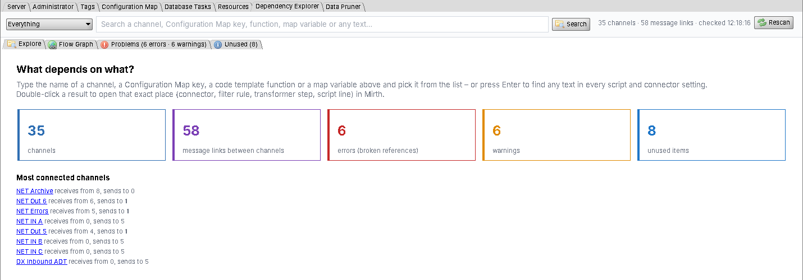

The tiles on the welcome page are shortcuts: click a tile to go to the flow graph, the problems or the unused
items. "Most connected channels" lists the channels with the most links.

## 4. Searching

Type in the search box. Suggestions appear as you type:

| Badge | What it searches for |
|---|---|
| **Channel** | Everything the channel depends on and everything that depends on it |
| **Config Map** | Every place that reads the Configuration Map key (keys that are read but not defined also appear) |
| **Function** | Where a code template function is defined and every place that calls it |
| **Map variable** | Every place that writes or reads a channelMap / globalMap / … variable |
| **Text** | Plain text search in every script and setting (also comments, SQL, URLs, templates) |

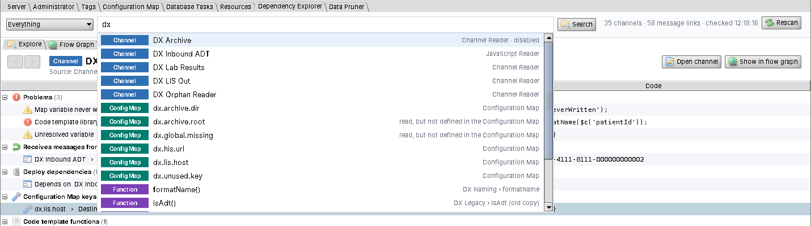

Pick a suggestion with the mouse or the arrow keys and Enter. Pressing Enter on text that is not in the list runs
a text search. The drop-down on the left limits the suggestions to one kind.

## 5. Results

Results are a tree you can expand and collapse: **group › item › place**. The columns show what the place does
(*Reads ($cfg)*, *Writes (globalMap)*, *Calls*, *Channel Writer* …), the line number and the code line.

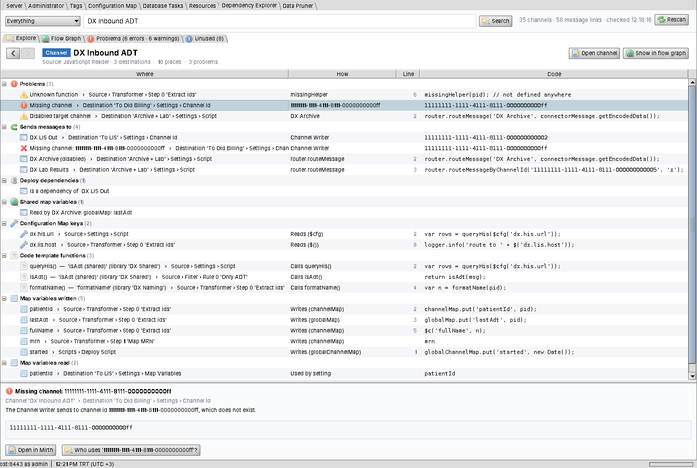

For a **channel** the groups are:

| Group | Contents |
|---|---|
| Problems | Broken references inside this channel |
| Receives messages from | Channels sending to it (Channel Writer, `router.routeMessage`, its id used in code) |
| Sends messages to | Channels it sends to, including **missing** ones (red ✖) and disabled ones |
| Deploy dependencies | *Channel › Set Dependencies* in both directions |
| Shared map variables | `globalMap` variables it writes that other channels read, and the reverse |
| Configuration Map keys | The keys it reads, with the exact places |
| Code template functions | The functions it calls and the template / library they come from |
| Map variables written / read | Its map variables (including Mapper steps, Channel Writer *Map Variables*, metadata columns, the response variable) |

The **detail pane** under the tree shows the selected row: the full location, an explanation and the code line,
with these buttons:

- **Open in Mirth**: go to the place (double-click or Enter does the same).
- **Dependencies of '…'**: search the channel of that row (e.g. the target of a Channel Writer).
- **Who uses '…'?**: search the key, function or variable of the row.

**◀ ▶** in the result header go back and forward through earlier searches. The right-click menu also has *Copy
location*, *Expand all* and *Collapse all*.

## 6. Open in Mirth

Double-click any result to open the place in the Mirth editor:

| Where | What opens |
|---|---|
| Connector setting | Channel editor › *Source* or *Destinations* with the destination selected; the field holding the reference is selected |
| Filter rule / transformer step / response transformer step | The filter / transformer editor of that connector with the rule / step selected (also inside iterators) and the line selected |
| Channel script (deploy, undeploy, preprocessor, postprocessor) | Channel editor › *Scripts* with that script and the line selected |
| Code template | *Edit Code Templates* with the template selected and the line selected |
| Global script | *Edit Global Scripts* with that script and the line selected |
| Configuration Map key | *Settings › Configuration Map* with the key selected |

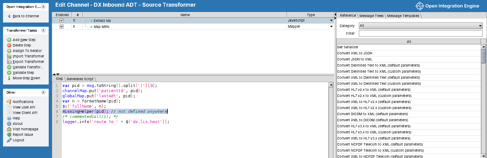

Unsaved changes in the editor are handled the way Mirth normally does: you are asked whether to save before the
editor switches to another channel.

## 7. Flow graph

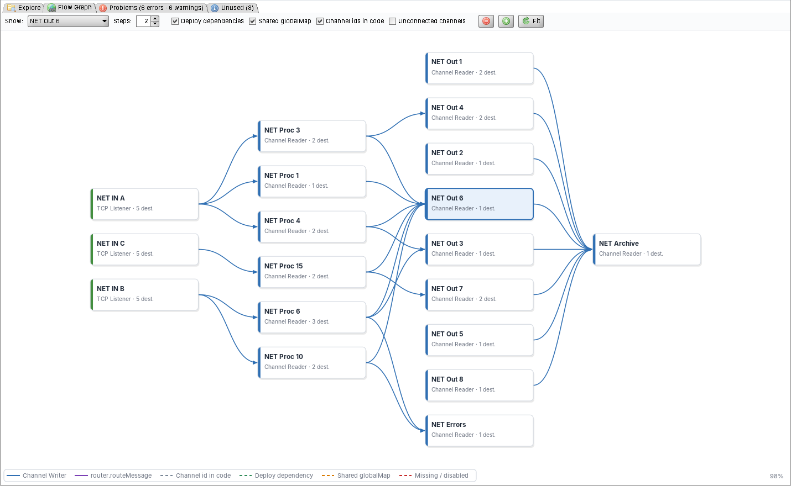

- **Boxes** are channels. The coloured bar on the left shows the source type. The red and orange badges show the
  number of errors and warnings in the channel. Disabled channels are grey with a dashed border. A red dashed box
  is a **missing channel**: one that is referenced, but no channel has that id or name.
- **Arrows** show messages or dependencies between channels:

  | Line | Meaning |
  |---|---|
  | blue | Channel Writer destination |
  | purple | `router.routeMessage(…)` / `routeMessageByChannelId(…)` |
  | grey, dashed | A channel id used in a script or setting (e.g. kept in a variable) |
  | green, dashed | Deploy dependency (*Set Dependencies*) |
  | orange, dashed | A `globalMap` variable written by one channel and read by the other |
  | red, dashed | The target channel is missing, or the destination / step is disabled |

- **Show:** *All connected channels* (unconnected channels can be added with the tick box) or one channel and its
  neighbours up to **Steps** links away.
- Mouse: the wheel zooms, dragging the background moves the view and dragging a box moves the box. Hovering
  highlights a channel's links; the tooltip lists its destinations. Double-click a channel to see its
  dependencies; right-click for more.
- The layout runs from left (senders) to right (receivers). Separate groups of channels are drawn apart, and
  loops are handled.

## 8. Problems (broken references)

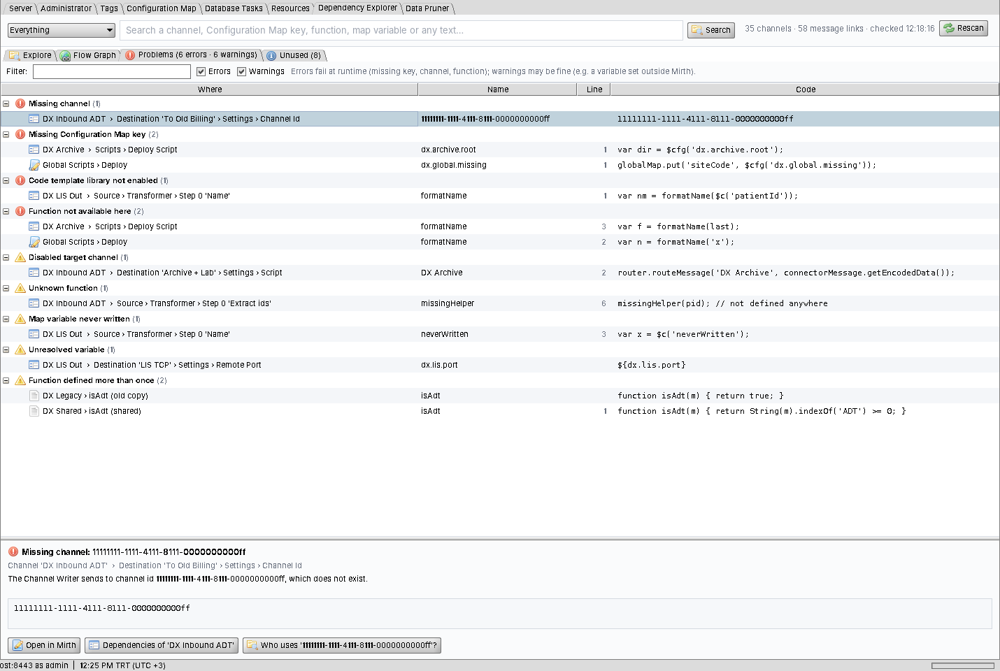

**Errors** fail at runtime. **Warnings** may be intended, but are worth a look.

| Category | Severity | When |
|---|---|---|
| Missing channel | Error | A Channel Writer, `router.routeMessage('name')` or `routeMessageByChannelId('id')` targets a channel that does not exist |
| Missing Configuration Map key | Error | `$cfg('k')` / `configurationMap.get('k')` reads a key that is not in the Configuration Map |
| Code template library not enabled | Error | The channel calls `f()`, but the library defining `f` is not enabled for this channel |
| Function not available here | Error | The template defining `f` is not enabled for that kind of script (its *Context*, e.g. called from a deploy script but only enabled for filters/transformers) |
| Function not added to scripts | Error | `f` is only defined in a *Drag-and-Drop* template, and those are not added to scripts |
| Disabled target channel | Warning | Messages are sent to a disabled channel |
| Unknown function | Warning | `f()` is not defined in any code template or in the item itself, and is not a JavaScript / Rhino / Mirth built-in |
| Map variable never written | Warning | `$c('k')`, `channelMap.get('k')` … reads a variable that nothing writes |
| Unresolved variable | Warning | `$('k')` or `${k}` matches neither a Configuration Map key nor any map variable written anywhere |
| Function defined more than once | Warning | Several code templates define the same function; which one wins depends on load order |

Problems that repeat in many channels (e.g. the same unresolved variable in 200 channels) are shown **once per
name**, with the number of channels. *Who uses …?* lists every place.

## 9. Unused items

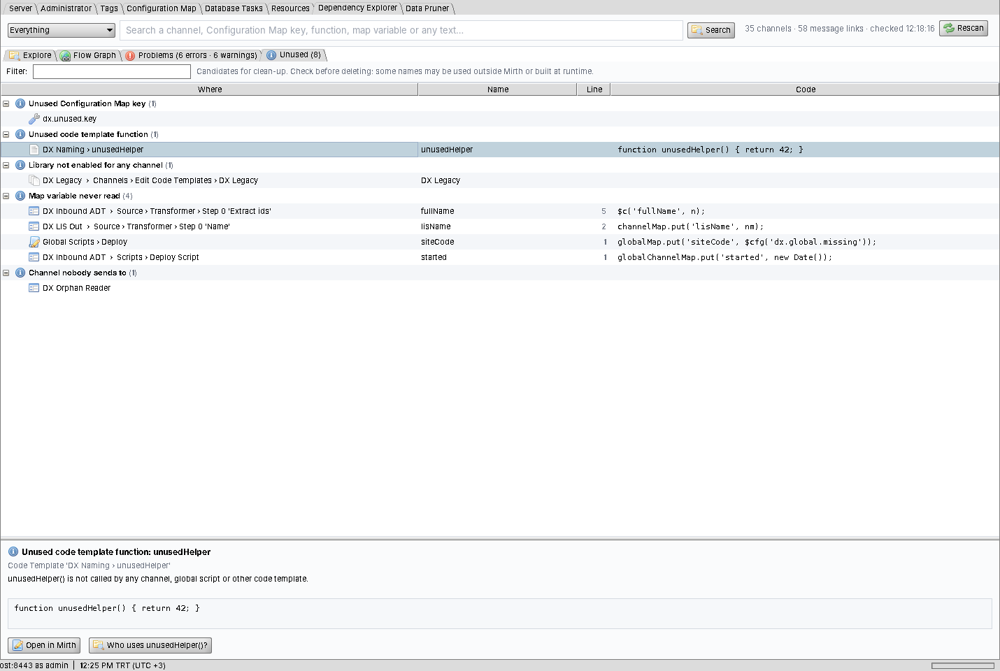

| Category | When |
|---|---|
| Unused Configuration Map key | No channel, code template or global script reads the key |
| Unused code template function | No channel, global script or other template calls the function |
| Library not enabled for any channel | A code template library is enabled for no channel; only global scripts could use it |
| Map variable never read | A variable is written, but nothing reads it (`$()`, `get`, `${…}`, metadata columns, Channel Writer map variables, response variable) |
| Channel nobody sends to | The source is a *Channel Reader*, so only other channels can feed it, but no channel does |

These are **candidates for clean-up**. Check before deleting: a name may be used by something outside Mirth, or
be built at runtime (see [§13](#13-limits)).

## 10. View Dependencies for one channel

*Channels › select a channel › View Dependencies* (or right-click › *View Dependencies*) opens a separate window
with the same *Explore* view for that channel, and the flow graph centred on it (one step; more with *Steps*).
The window is not modal: you can keep working in Mirth. "Open in Mirth" brings the editor to the front.

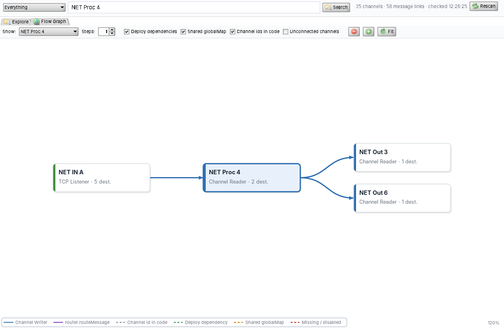

## 11. Web administrator (OIE Web Support)

The [OIE Web Administrator](https://openintegrationengine.org/news/web-administrator/) is served by the
**Web Support** extension (at `https://<host>:8443/oie-webadmin/`). It loads the web UI of every installed
extension that carries a `webadmin/` folder. Dependency Explorer ships one inside the same zip, so **one install
gives both administrators**. Web Support itself needs no change, and no extra install is needed for the web part.

| | |
|---|---|
| Settings › **Dependency Explorer** | The same explorer: Explore, Flow Graph, Problems, Unused |
| Channels › right-click / Channel Tasks › **View Dependencies** | Opens the explorer for that channel (`/oie-webadmin/dependency-explorer?channel=<id>`) |
| Command palette | "Dependency Explorer" |

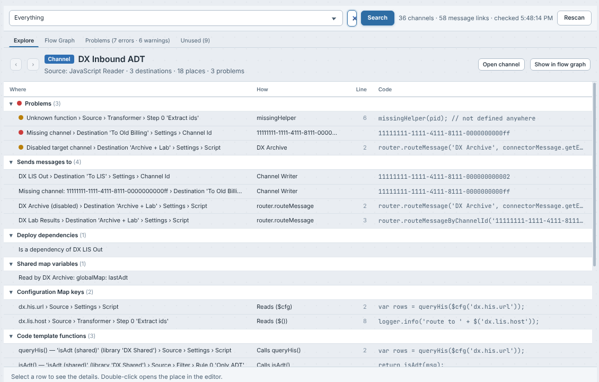

**Open in editor** works in the web administrator too:

| Where | What opens |
|---|---|
| Filter rule / transformer step / response transformer step | The filter / transformer editor of that connector (`/channels/<id>/transformer/<metaDataId>` …), with the step selected and the code line selected in the script editor |
| Connector setting | The channel editor › *Source* or *Destinations*, with the destination selected and the setting field holding the reference selected |
| Channel script | The channel editor › *Scripts*, with that script and the line selected |
| Code template / global script / Configuration Map key | That view, with the template / script / key selected |

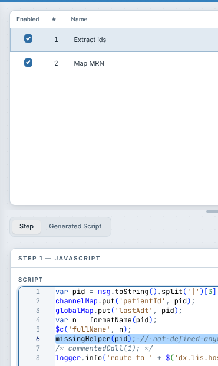

The web UI follows the web administrator's light and dark themes.

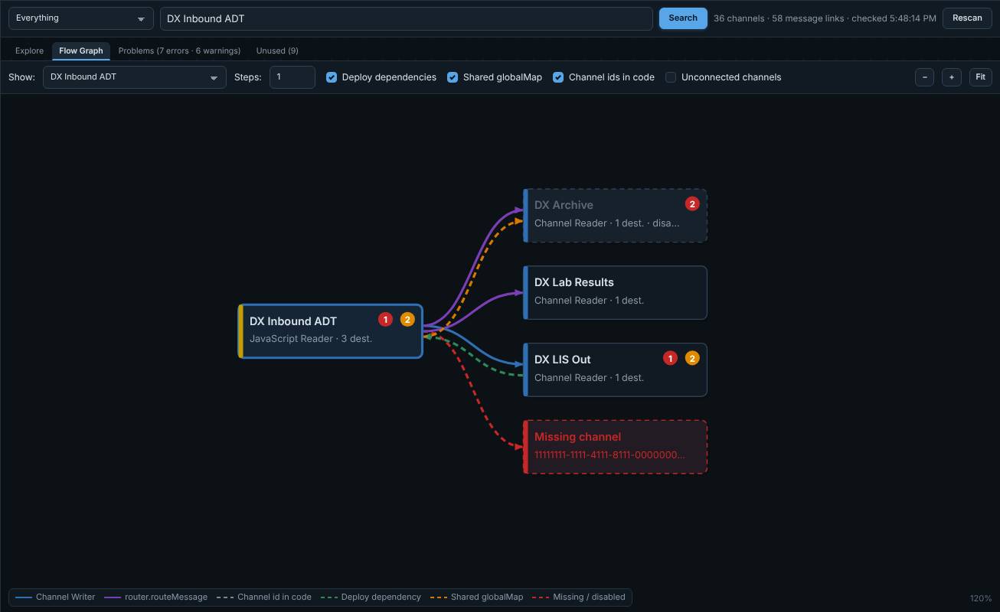

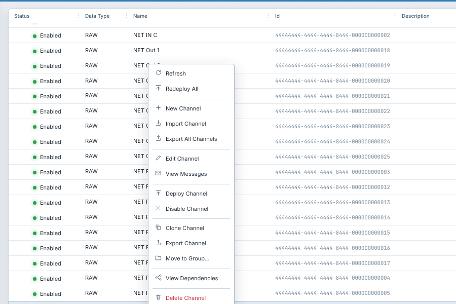

Notes:

- The web administrator has no API for selecting a tab, step or line, so the plugin selects them the way a user
  would click them, once the editor has opened. If a future web administrator renders these differently, the
  editor still opens at the right channel / connector, and the location is shown in a notification.
- The web administrator numbers steps from 1 in its list; the results show Mirth's sequence numbers (from 0), the
  same as the Swing editor.
- Web Support currently requires OIE 4.6.0. On engines without it (e.g. 4.5.2), the `webadmin/` folder is simply
  not used. The Swing part works as before.
- The web part declares `"oie": { "apiMin": "4.6" }` in its `plugin.json`, so a web administrator older than
  that API skips it with a clear message instead of failing.

## 12. What is recognised

The plugin reads the whole configuration: every connector setting, filter rule, transformer and response
transformer step (including iterator children), the channel scripts, the batch and attachment scripts, the
custom metadata columns, the code templates and the global scripts. In JavaScript, comments are ignored, so
commented-out code does not count as a use.

| Reference | Recognised forms |
|---|---|
| Configuration Map | `$cfg('k')`, `configurationMap.get('k')`; also `$('k')` and `${k}` (Velocity, in connector settings), which Mirth also resolves from the Configuration Map |
| Map write | `channelMap.put('k', …)`, `globalChannelMap`, `globalMap`, `connectorMap`, `responseMap` · `$c('k', v)`, `$co`, `$gc`, `$g`, `$r` · Mapper step variable (with its scope) |
| Map read | `….get('k')`, `….containsKey('k')`, `$c('k')`, `$co`, `$gc`, `$g`, `$r`, `$s`, `$('k')`, `${k}`, metadata column mapping, Channel Writer *Map Variables*, source response variable |
| Channel → channel | Channel Writer target, `router.routeMessage('name' or 'id', …)`, `router.routeMessageByChannelId('id', …)`, any existing channel id in a script or setting, deploy dependencies |
| Functions | Definitions `function f(…)` in code templates; calls `f(…)` that are not method calls (`x.f(…)`); local functions, variables, parameters and `catch` variables are taken into account |

Mirth's own channel export data (tags, metadata) is skipped, so a tag that lists every channel does not create
false links.

## 13. Limits

The analysis is **static**: it reads the configuration, not the running messages. So:

- Names built at runtime are not recognised. Examples: `$c(prefix + 'Id')`, `router.routeMessage(target, …)` where
  `target` is a variable, a function called through `eval` or kept in a map. A channel id kept in a variable *is*
  found (grey dashed link) when the id itself appears somewhere in the channel.
- Systems outside Mirth (files, databases, other Mirth servers, HTTP callers) are not part of the graph. A key
  that looks unused may still be read by them through the API.
- *Unknown function* and *Unresolved variable* are warnings, not errors: a function may come from a Java library
  (`Packages…` with an unusual call style), and a variable may be set by a connector the plugin does not know.
- Code templates call each other freely. Whether a function used *inside* a template is available is checked where
  the template is used, not in the template itself.

## 14. Performance and memory

Measured on a test server with **240 channels** (200 of them with 10 destinations and many transformer steps;
about 40 MB of configuration):

| | |
|---|---|
| First read after a server start | about 3 s (plus Mirth's own first channel load, 5–10 s on that server) |
| Later views / searches | 50–400 ms; changes are detected per channel revision, and only changed channels are read again |
| A search with 2 000 places | about 0.3 s |
| Memory kept on the server | about **3 MB** for those 240 channels (code texts are kept compressed; only the references are indexed) |

The plugin reads one channel at a time and checks first that the heap has room. When it does not, it shows a clear
message instead of risking an *OutOfMemoryError* in Mirth. Only one read runs at a time; other requests wait for it.
Nothing runs in the background: the plugin only works while someone uses the explorer.

## 15. Permissions and REST API

The plugin adds one permission, **View Dependency Explorer**. It covers the Settings tab, the channel window and
the API below. Users without it do not see the tab; their requests are refused.

| Method | Path | Returns |
|---|---|---|
| `GET` | `/api/extensions/depexplorer/overview?refresh=false` | Channels, flow graph edges, suggestion lists, counts |
| `POST` | `/api/extensions/depexplorer/_query` | Body `<…DepQuery><type>CHANNEL\|CONFIG\|FUNCTION\|MAPVAR\|TEXT</type><key>…</key></…DepQuery>` → result rows |
| `GET` | `/api/extensions/depexplorer/report` | Problems and unused items |

`refresh=true` reads everything again (the *Rescan* button).

## 16. Building from source

Requirements: JDK 11 or newer, and a Mirth Connect / OIE 4.5.2+ installation to compile against.

```
java Build.java --mirth "C:\Program Files\Mirth Connect"
java Build.java --mirth /opt/mirthconnect
```

The result is `dist/depexplorer-<version>.zip`. The build compiles Java 8 bytecode, generates the version list in
`plugin.xml` and signs the client jars with a self-signed key (`keystore/depexplorer-signing.p12`, created on the
first build; you can replace it with a corporate certificate). `--no-sign` skips signing.

The web half (`webadmin/web/plugin.tsx`, React/TypeScript) is compiled to `webadmin/web/plugin.js` with Node.js:

```
cd webadmin
npm install
npm run build
```

The compiled `plugin.js` is kept in the source tree, so `java Build.java` works without Node.js; the build refuses
to package if it is missing. React is not bundled: the plugin uses the web administrator's own React
(`platform.React`), and the compiled file has no other dependencies.

Project layout:

```
src/shared   DTOs and the REST interface (client + server)
src/server   Scanner (reads channels/templates/scripts), DepModel (cache, change detection), Analysis (graph, problems, unused, queries)
src/client   ExplorerView, ResultTree, FlowGraph, SuggestField, Navigator ("Open in Mirth"), Settings tab and Channel Task plugins
webadmin     Web administrator half: plugin.json + web/plugin.tsx (compiled to web/plugin.js)
```

## 17. Version history

**1.1.0**: OIE Web Administrator support.

- The same explorer in the web administrator (needs the Web Support extension), shipped in the same zip:
  Settings tab, *View Dependencies* in the channel menu and Channel Tasks, and a command palette entry.
- "Open in editor" in the web administrator opens the filter / transformer / channel editor at the
  connector and step and selects the code line.
- No change to the server side or to the Swing UI.

**1.0.0**: first version.

- "Who uses it?" search for channels, Configuration Map keys, functions, map variables and text, with
  suggestions.
- Result tree with detail pane and "Open in Mirth" (connector, rule, step and line).
- Channel flow graph: layered layout, zoom and pan, focus with steps, five link kinds, missing and disabled
  channels.
- Problems report (10 categories) and unused-items report (5 categories).
- *View Dependencies* in Channel Tasks and the channel right-click menu.
- Installs on Mirth / OIE 4.5.2 – 4.19.19.
